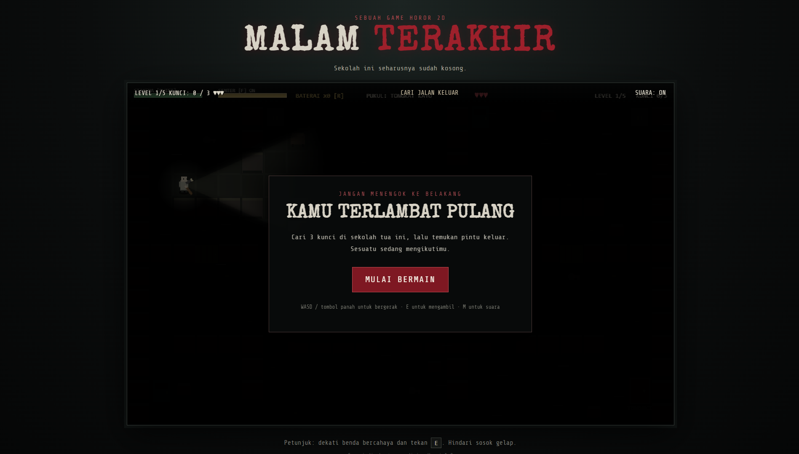
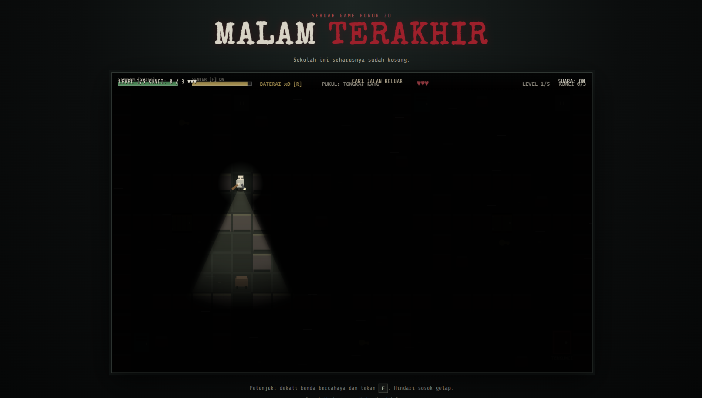

# Game Seram: Labirin Sekolah Berhantu

**Game Seram** adalah game web horor-survival berbasis 2D di mana pemain harus menjelajahi lorong-lorong labirin sekolah yang gelap untuk mengumpulkan semua kunci dan keluar dengan selamat, sembari menghindari kejaran hantu dan penjaga misterius.

---

## Fitur Utama
- **Sistem Senter & Baterai:** Senter membantu melihat jalan di kegelapan, namun baterai bisa habis seiring waktu dan perlu diisi ulang.
- **Mekanik Bersembunyi:** Masuk ke dalam loker (`Locker`) untuk bersembunyi dari kejaran musuh saat tertangkap basah.
- **Sistem Senjata / Alat Pukul:** Temukan dan upgrade alat pukul di lemari (`Cabinet`) untuk melawan musuh.
- **AI Musuh Cerdas:** Musuh memiliki mode patroli, mengejar, hingga mencari pemain berdasarkan suara atau cahaya senter.
- **Multi-Level:** Terdiri dari 5 level dengan tingkat kesulitan dan tata letak labirin yang semakin menantang.
- **Dukungan Gamepad:** Bisa dimainkan menggunakan keyboard maupun stik game (Gamepad/Controller).

---

## Kontrol Permainan

| Aksi | Keyboard | Gamepad |
| :--- | :--- | :--- |
| **Gerak** | Tombol Arah / `W`, `A`, `S`, `D` | Left Stick / D-Pad |
| **Lari** | `Shift` (Tahan) | L2 / Klik Stick |
| **Interaksi (Ambil/Buka/Sembunyi)** | `E` | Tombol A / X |
| **Serang** | `Klik Kiri / Spasi` (jika ada senjata) | Tombol B |
| **Nyalakan/Matikan Senter** | `F` (atau sesuai kode) | Tombol Y |
| **Ganti Baterai** | `R` | L1 |

---

## Teknologi yang Digunakan
- **HTML5 Canvas** untuk rendering game 2D.
- **JavaScript (ES6+)** untuk logika *gameplay*, AI musuh, dan sistem navigasi labirin.
- **CSS3** untuk antarmuka menu dan tampilan *UI*.
- **Web Audio API** untuk efek suara (*sound effects*) prosedural tanpa file audio eksternal.

---

## Cara Menjalankan Game
1. Clone atau download repository ini.
2. Buka file **`index.html`** menggunakan browser web modern (Chrome, Firefox, Edge, dll).
3. Klik **Mulai** dan nikmati permainan!

